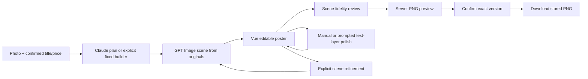

# Designs Index

> One matching file per feature. Requirements are approved; the complete phase-2 design below was approved on 2026-11-09 (ADR-031).

| Design file | Requirements / sections | Status |
|---|---|---|
| [shop-dashboard.md](shop-dashboard.md) | R-SHOP-DASH-001…009 | v4 mobile amendment implemented locally for 005–009 (ADR-119, T-SHOP-DASH-006–011). v3 implemented locally (ADR-114–118), 2026-11-18; real-device and screen-reader release checks pending |
| [editor-refinements.md](editor-refinements.md) | R-EDITOR-REFINEMENTS-001…004 / D-001…003 | Approved autonomously after independent review, 2026-11-14 |
| [catalogue-brand.md](catalogue-brand.md) | R-CATALOGUE-BRAND-001/002; D-001 intake, D-002 profile, D-003 shared access/API conventions | Approved v1 (ADR-031); D-004 compact rendered contact and logo-only identity, D-005 brand mark (R-CATALOGUE-BRAND-003/004): D-005 approved v2.1 on 2026-11-12 (ADR-054); D-004 v2.1 approved and built, then reopened: v3.1 (drawn contact with the rendered line as fallback, ADR-055) approved on 2026-11-12 (ADR-056); D-006 logo seal (R-CATALOGUE-BRAND-005): approved v2.1 on 2026-11-12 (ADR-057) |
| [generation-jobs.md](generation-jobs.md) | R-GENERATION-JOBS-001/002; D-001 Claude planning, D-002 queue/spend/recovery, D-003 failures | Approved v1 (ADR-031) |
| [product-visuals.md](product-visuals.md) | Existing R-001–008 / D-001–008; new R-009–011 / D-009–011 | Phase 1 approved (ADR-012); normal-poster v2 approved (ADR-031) |
| [poster-editor.md](poster-editor.md) | R-POSTER-EDITOR-001–003; D-001 document/editor, D-002 review/confirm, D-003 manual/prompted text effects. R-POSTER-EDITOR-004–007; D-004 steps, tabs, removal, glass chrome; D-005 phone-first editor (part A structure, part B look) | Approved v1 (ADR-031); D-004 approved 2026-11-13 under the autonomy grant, reviewed after building (ADR-072, ADR-073); D-005 v2 after a review and a devil's advocate: part A approved, part B waits for the user (ADR-075) |
| [format-export.md](format-export.md) | R-FORMAT-EXPORT-001/002; D-001 formats, D-002 stored-preview confirmation/download | Approved v1 (ADR-031) |
| [creation-library.md](creation-library.md) | R-CREATION-LIBRARY-001/002; D-001 revisions/recovery, D-002 reuse. R-CREATION-LIBRARY-003/004; D-003 manage posters, D-004 manage saved styles | D-001/002: Approved v1 (ADR-031). D-003/004: Approved v2.1 on 2026-11-12 (ADR-061) |
| [hosted-pilot.md](hosted-pilot.md) | R-HOSTED-PILOT-001–006; D-001 access, D-002 session and home screen, D-006 first phone session (phase A); D-003 data and spend, D-004 backups, D-005 deploy and status (phase B, outline) | v2 approved 2026-11-13 under the autonomy grant (ADR-065) after one review round and a devil's advocate; phase B is re-scoped and reviewed again after the phone session |

## Approval packet — 2026-11-09

Requirements approval: ADR-028; separate editable text/effect choice: ADR-030. Architectural proposal: ADR-029.

The six files define concrete data, endpoints, state transitions, failure handling and verification. Approved decisions:

- FastAPI + SQLite + existing asset store, one process/durable local queue; old and new provider ledgers share the budget. Preserve evaluation rules/data independently.
- GPT Image original-reference integration first; selected scene + originals for full-scene refinements. Optional cutout later, without a stale baked shadow.
- Claude generates validated scene plans or selected-layer patches. Commercial values stay authoritative; prompt-based price/title changes require explicit content acknowledgement.
- Konva/vue-konva with a saved application document. Exact font glyphs remain editable; optional GPT Image material swatches are clipped to the selected text layer. No whole-poster regeneration for lettering polish, no surface-embedded text in this version.
- Shared renderer in pinned Chromium produces the final PNG before confirmation. Confirmation binds that preview/hash; repeat download returns identical bytes.
- One authenticated shop workspace, optimistic revision checks, idempotent actions, immutable saved/confirmed versions and explicit failed/interrupted job states.

Approved delivery order: intake/profile/access + persistence → plan/job/scene path → feed editor/fidelity review → manual/prompted text polish → exact PNG confirmation/download → square/story → optional preserved-photo route. Implementation tasks are now tracked in TODO (ADR-031).

Paid tests are separate: verify the new Claude planner, sizes, selected-scene references and text textures within an explicit budget before production claims. Existing JBL/Soundcore evidence covers only the current initial-scene path. No UI/renderer prototype, new dependency installation, paid call or implementation code was produced during design.

See [requirements](../requirements/_INDEX.md), [decisions](../DECISIONS.md) and [AGENTS workflow gates](../../../AGENTS.md). Previous phase-1 design review rounds are not approval of these new sections.
| [poster-format.md](poster-format.md) | R-POSTER-FORMAT-001/002; D-POSTER-FORMAT-001 formats and the model's shape | Approved v2 (ADR-080) |
| [text-first-generation.md](text-first-generation.md) | R-TEXT-FIRST-001 … 005 (004 and 005 amended by ADR-099, with D-TEXT-FIRST-005 v4 "a change is a set of fields", approved 2026-11-15 under the autonomy grant); D-TEXT-FIRST-001 to 005 creation by message | Approved v2 2026-11-14 under the autonomy grant (ADR-094) |
| [multi-shop.md](multi-shop.md) | R-MULTI-SHOP-001 … 006; D-MULTI-SHOP-001 … 007 | Approved v4 (ADR-107), amended 2026-11-16 (ADR-108); built (T-MULTI-SHOP-001 … 006) |
| [prepaid-balance.md](prepaid-balance.md) | R-BALANCE-001 … 007; D-BALANCE-001 … 006 | Approved v4 (ADR-109); tasks T-PENDING-KINDS, T-BALANCE-001 … 006 in TODO.md |
| [admin-dashboard.md](admin-dashboard.md) | R-ADMIN-001 … 006; D-ADMIN-001 … | Approved v3 (ADR-110); tasks T-ADMIN-001 … 010 in TODO.md, 008-010 may move after Release 1 on the user's word |
| [service-terms.md](service-terms.md) | R-TERMS-001 … 003; D-TERMS-001 … | Approved v3 (ADR-112); tasks T-TERMS-001 … 004 in TODO.md; no erase command in Release 1 |
| [share-poster.md](share-poster.md) | R-SHARE-001 … 005; D-SHARE-001 … 005 | Approved v3 (ADR-120); tasks T-SHARE-001 … 005 in TODO.md; one read-only field on the poster read, no migration |
| [interface-polish.md](interface-polish.md) | R-POLISH-001 … 005; D-POLISH-001 … 005 | Approved v2 (ADR-122); tasks T-POLISH-001 … 005 in TODO.md; presentation only, no route and no migration |
