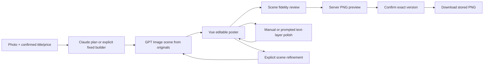

# Designs Index

> One matching file per feature. Requirements are approved; the complete phase-2 design below was approved on 2026-11-09 (ADR-031).

| Design file | Requirements / sections | Status |
|---|---|---|
| [catalogue-brand.md](catalogue-brand.md) | R-CATALOGUE-BRAND-001/002; D-001 intake, D-002 profile, D-003 shared access/API conventions | Approved v1 (ADR-031); D-004 compact rendered contact and logo-only identity, D-005 brand mark (R-CATALOGUE-BRAND-003/004): D-005 approved v2.1 on 2026-11-12 (ADR-054); D-004 v2.1 approved and built, then reopened: v3.1 (drawn contact with the rendered line as fallback, ADR-055) approved on 2026-11-12 (ADR-056) |
| [generation-jobs.md](generation-jobs.md) | R-GENERATION-JOBS-001/002; D-001 Claude planning, D-002 queue/spend/recovery, D-003 failures | Approved v1 (ADR-031) |
| [product-visuals.md](product-visuals.md) | Existing R-001–008 / D-001–008; new R-009–011 / D-009–011 | Phase 1 approved (ADR-012); normal-poster v2 approved (ADR-031) |
| [poster-editor.md](poster-editor.md) | R-POSTER-EDITOR-001–003; D-001 document/editor, D-002 review/confirm, D-003 manual/prompted text effects | Approved v1 (ADR-031) |
| [format-export.md](format-export.md) | R-FORMAT-EXPORT-001/002; D-001 formats, D-002 stored-preview confirmation/download | Approved v1 (ADR-031) |
| [creation-library.md](creation-library.md) | R-CREATION-LIBRARY-001/002; D-001 revisions/recovery, D-002 reuse | Approved v1 (ADR-031) |

## Approval packet — 2026-11-09

Requirements approval: ADR-028; separate editable text/effect choice: ADR-030. Architectural proposal: ADR-029.

The six files define concrete data, endpoints, state transitions, failure handling and verification. Approved decisions:

- FastAPI + SQLite + existing asset store, one process/durable local queue; old and new provider ledgers share the budget. Preserve evaluation rules/data independently.
- GPT Image original-reference integration first; selected scene + originals for full-scene refinements. Optional cutout later, without a stale baked shadow.
- Claude generates validated scene plans or selected-layer patches. Commercial values stay authoritative; prompt-based price/title changes require explicit content acknowledgement.
- Konva/vue-konva with a saved application document. Exact font glyphs remain editable; optional GPT Image material swatches are clipped to the selected text layer. No whole-poster regeneration for lettering polish, no surface-embedded text in this version.
- Shared renderer in pinned Chromium produces the final PNG before confirmation. Confirmation binds that preview/hash; repeat download returns identical bytes.
- One authenticated shop workspace, optimistic revision checks, idempotent actions, immutable saved/confirmed versions and explicit failed/interrupted job states.

Approved delivery order: intake/profile/access + persistence → plan/job/scene path → feed editor/fidelity review → manual/prompted text polish → exact PNG confirmation/download → square/story → optional preserved-photo route. Implementation tasks are now tracked in TODO (ADR-031).

Paid tests are separate: verify the new Claude planner, sizes, selected-scene references and text textures within an explicit budget before production claims. Existing JBL/Soundcore evidence covers only the current initial-scene path. No UI/renderer prototype, new dependency installation, paid call or implementation code was produced during design.

See [requirements](../requirements/_INDEX.md), [decisions](../DECISIONS.md) and [AGENTS workflow gates](../../../AGENTS.md). Previous phase-1 design review rounds are not approval of these new sections.
