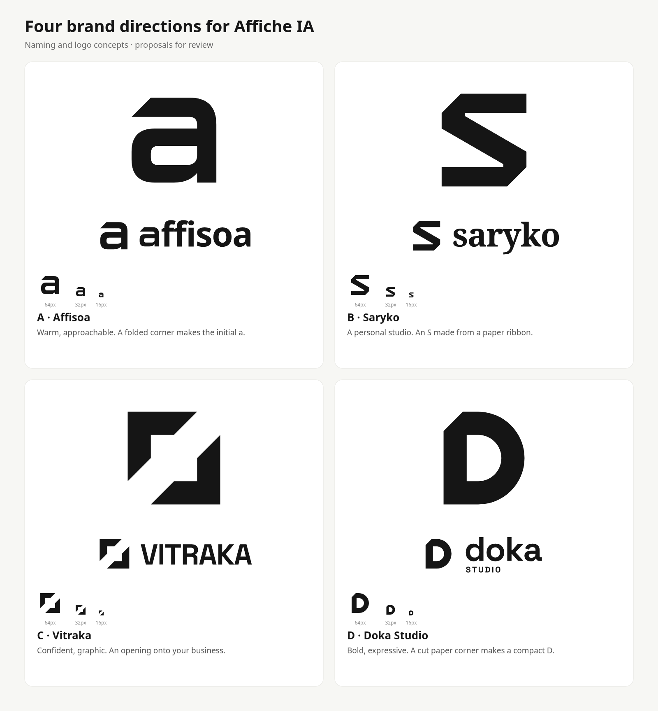

# Naming and brand identity concepts

**Date:** 2026-11-15. **Status:** Naming exploration archived after the user selected **Doka Studio**, then the **Signal** identity direction. Application rollout remains separate. Created with the explicitly requested `logo-design` skill; these are concept assets, not a finished production kit.

[Original three-direction overview](concepts.png) · [Doka Studio detail](doka-studio-concept.png)

## Working brief

Affiche IA helps shop owners turn their own product photographs and verified offers into promotional images. The audience is Malagasy shop owners first, using phones and a French interface. The identity should feel approachable, capable, clear and commercially credible, with room for later publishing and business features. The user is the decision-maker and explicitly invited new names.

Assumptions: retain no existing logo equity; favor easy spoken names and compact app symbols; avoid presenting the product as a general photo editor or promising sales growth. No requirement to retain “IA” in the name. The app remains named Affiche IA until a direction is chosen and its rollout separately authorized.

Category cues intentionally avoided: magic wands, generic AI sparkles, robot heads, camera apertures, gradient blobs and a chat bubble used as the whole identity. The word map connects **product → picture → paper → poster**, **shop → display → window → visibility**, and **ownership → signature → initial**. Chosen approaches are a letterform/wordmark-led combination, a folded-ribbon monogram, and an abstract framing symbol.

## A Affisoa

**Positioning:** A helpful local partner that makes a shop's products look well presented.

**Name:** A coined combination of French *affiche* and Malagasy *soa*. The dictionary supports *soa* as good/beautiful; “Affisoa” itself is an invented brand name, not a claimed dictionary expression. Suggested pronunciation: “af-fi-so-a.” [Meaning of soa](https://malagasyword.org/bins/teny2/soa)

**Logo:** A solid lowercase **a** with a diagonal folded corner. The same initial is built into the wordmark, so the icon and name share an identifiable detail. Broad counters and generous strokes suit phone sizes.

**Proposed palette:** terracotta `#AD432D`, warm cream `#F8F1E6`, dark brown `#2A211E`. Terracotta is the main brand accent; cream provides breathing room for colorful customer posters. This is a palette proposal, not finalized color artwork.

**Type:** A customized Noto Sans Bold wordmark, outlined as vector paths. Noto Sans for the proposed everyday interface/copy gives a direct, friendly voice with accented French support.

**Tagline:** “Vos produits, bien présentés.”

**Voice and visual language:** Practical, warm and clear. Example: “On prépare votre prochaine affiche ?” Use the folded corner as a small graphic accent, with product photography carrying the message. Avoid applying the app's terracotta to every customer's poster; the service identity and customer brand remain separate.

**Tradeoff:** Most immediate link to the current product, but a longer name to spell and less neutral if the business eventually expands far beyond promotional visuals.

[Symbol](affisoa-symbol.svg) · [Wordmark lockup](affisoa-lockup.svg)

## B Saryko

**Positioning:** A personal creative studio for a shop owner.

**Name:** A coined name built around Malagasy *sary* (picture/image). The spelling “Saryko” is a brand construction; it is not presented as the literal grammatical translation of “my picture.” Suggested pronunciation: “sa-ri-ko.” [Meaning of sary](https://malagasyword.org/bins/teny2/sary)

**Logo:** A single angular paper ribbon forms an **S**. A bold serif wordmark provides a more editorial, crafted personality than the other directions.

**Proposed palette:** forest `#174C3C`, paper cream `#F6F1E6`, muted gold `#E3B85F`. Forest is primary; gold is a restrained accent with forest text, rather than a color for small white lettering.

**Type:** Outlined Noto Serif Bold wordmark and editorial headings; Noto Sans for interface text. Two families, both already available in the project.

**Tagline:** “Votre boutique a du style.”

**Voice and visual language:** Encouraging and creative without technical jargon. Example: “Donnons du style à votre prochaine offre.” Favor paper-like backgrounds, confident headings and thoughtful spacing. The ribbon can become a restrained edge or divider in future collateral.

**Tradeoff:** The shortest and most personal option, but may initially suggest a photo/creative app rather than a broader shop service. The angular symbol is deliberately firmer than the warm editorial type.

[Symbol](saryko-symbol.svg) · [Wordmark lockup](saryko-lockup.svg)

## C Vitraka

**Positioning:** A confident display and visibility tool for growing shops.

**Name:** A coined name intended to evoke French *vitrine*. No Malagasy dictionary meaning is claimed. Suggested pronunciation: “vi-tra-ka.”

**Logo:** Two broad, cut framing pieces leave a diagonal opening. It suggests giving a product space to be seen without illustrating a phone, camera or storefront literally. Its graphic character supports a more assertive identity.

**Proposed palette:** cobalt `#2449D8`, pale ice `#EFF3FF`, midnight `#101B3D`. Cobalt carries the signature; the light/dark neutrals keep product imagery readable.

**Type:** Outlined Space Grotesk Bold wordmark and headings, with the existing Noto Sans for body/interface text. Capitals emphasize confidence and structure.

**Tagline:** “Votre commerce prend sa place.”

**Voice and visual language:** Brief and confident. Example: “Présentez vos produits avec assurance.” Angular framing, larger headings and strict alignment suit a later dashboard and publishing service.

**Tradeoff:** Broadest positioning, but the name explains the product less directly and framing motifs are common in creative software. This direction would benefit most from further distinctiveness work if selected.

[Symbol](vitraka-symbol.svg) · [Wordmark lockup](vitraka-lockup.svg)

## D Doka Studio

**Positioning:** A bold creative studio for a shop's commercial visuals. This is the user's proposed name, added as a fourth option; it has not been selected for the application.

**Logo:** A custom geometric **D** with a cut paper corner. Its broad upright and curved bowl hold a large negative counter. The lowercase **doka** wordmark is paired with a clearly separated **STUDIO** descriptor. The symbol carries recognition at favicon sizes; the full name belongs in larger contexts.

**Proposed palette:** signal yellow `#F2C744`, charcoal `#20201D`, warm paper `#F5F1E8`. Use charcoal artwork/text on yellow; white text on yellow is unsuitable for small labels. These are palette proposals, not exported final identity variants.

**Type:** Outlined Space Grotesk Bold wordmark and descriptor, with Noto Sans for practical interface copy. Rounded letters keep the studio approachable; the clipped corner provides a firmer graphic detail.

**Tagline:** “Vos produits au premier plan.”

**Voice and visual language:** Direct, energetic and concise. Example: “Préparez votre prochaine affiche.” Use confident headings, simple paper-like panels and yellow accents while leaving customers' own poster styles independent of the app identity.

**Tradeoff:** Short and easy to say, with room beyond posters, but “Studio” can suggest an agency/service rather than a self-serve app. The name also has specific existing uses: Doka Studio appears in a music venue's own event listings, and **Doka** was the earlier name of the image editor now called Pintura. That is a naming consideration, not a legal clearance conclusion. [Existing Doka Studio use](https://www.volkshotel.info/en/agenda/doka/doka-studio-w-ctrlzora-suze-ijo/), [Pintura's migration history](https://pqina.nl/pintura/changelog/)

**Checks:** Two rendered iterations. The second centers the mark horizontally (44-unit side margins), enlarges STUDIO from 34 to 42 units and balances lockup margins. Final symbol audit: no issues, heuristic 100/100. Lockup audit: 91/100; notices concern supplied font angles and outline complexity. The source typeface's letter slopes were preserved. True-size, reverse, mirror, blur, circular-crop and shelf contexts were visually inspected; no production icon kit or physical print test was made.

Charcoal on yellow is **10.13:1** and charcoal on paper **14.49:1**. White on yellow is **1.61:1** and is not a proposed text pairing. The diagnostic test sheet shows that failing treatment deliberately; use the dark mark instead. Evidence lives in git-ignored `outputs/brand-directions-2026-11-15/doka-palette-checks.json` and the two rendered test sheets.

[Symbol](doka-studio-symbol.svg) · [Wordmark lockup](doka-studio-lockup.svg) · [Doka concept image](doka-studio-concept.png)

## Original recommendation before name selection

The user subsequently selected **Doka Studio** and requested further logo-design/imagegen exploration. Continue in [Doka Studio identity styles](../doka-studio-identity/README.md); the naming recommendation below is historical.

**Affisoa** is the strongest starting point for the confirmed audience: a friendly name connected to presenting offers, with an approachable symbol that reads at phone sizes. **Saryko** is the alternative for a more personal, editorial studio. **Vitraka** is the alternative for a sharper, more general business platform. **Doka Studio** adds a bolder studio-led alternative with a short main name; its documented naming overlap deserves checking before adoption. Names, marks and palettes can be recombined after feedback, but the finished system should follow one coherent direction.

## Exploration and checks

Nine one-sentence concepts were considered before building the original three. The user subsequently requested Doka Studio as a fourth direction; its cut-corner D was built and refined separately. Scores are design judgment, not user research; each dimension is scored out of five.

| Concept | Clarity | Distinction | Simplicity | Relevance | Small size | Total |
| --- | ---: | ---: | ---: | ---: | ---: | ---: |
| Affisoa folded-corner a, built | 5 | 4 | 5 | 5 | 5 | 24 |
| Affisoa speech-note emblem | 4 | 2 | 4 | 4 | 3 | 17 |
| Affisoa wordmark alone | 4 | 3 | 5 | 4 | 2 | 18 |
| Saryko paper-ribbon S, built | 5 | 4 | 5 | 4 | 5 | 23 |
| Saryko handwritten signature | 4 | 3 | 3 | 4 | 2 | 16 |
| Saryko nested-picture badge | 4 | 2 | 4 | 5 | 3 | 18 |
| Vitraka opening frame, built | 4 | 3 | 5 | 5 | 4 | 21 |
| Vitraka isolated V cut | 4 | 2 | 5 | 3 | 5 | 19 |
| Vitraka eye/daybreak symbol | 4 | 2 | 3 | 4 | 3 | 16 |

The logo skill's design/creative library conventions and four example SVG constructions were studied. Pagekit, Framer, Patreon and Precursor were used only in private shelf tests, not copied into the delivered logos. This comparison is not a comprehensive competitor or trademark search.

Two rounds were rendered and visually inspected. [Round 1](round-1/affisoa-symbol.svg) is retained alongside the other first-round symbols/lockups. Round 2 repeats Affisoa's custom initial in its wordmark and increases Vitraka's frame thickness for small sizes. Saryko's first construction was retained after the scale checks.

- All eight current symbol/lockup SVGs are vector-only and contain no live text, raster images, filters or masks.
- Symbol audits reported no issues, with heuristic scores of 100/100. The original wordmark audits scored 98, 99 and 92; the Doka addition scored 91; remaining notices concern outline complexity/precision and the supplied Space Grotesk letter angles. Font letterforms were not snapped to an icon grid. These scores do not certify originality or production readiness.
- The overview and Chromium test sheets were inspected for true 16/32/64 px size, white/reversed treatments, blur, mirror/rotation, circular avatar, browser-tab and header contexts. The unchanged black artwork is deliberately unreadable on black in the diagnostic sheet; the reversed treatment is the appropriate one there. No physical print or embroidery test was run.
- Contrast checks: Affisoa terracotta on cream **5.17:1**, white on terracotta **5.80:1**; Saryko forest on cream **8.73:1**, forest on gold **5.29:1**; Vitraka cobalt on ice **6.27:1**, midnight on ice **15.19:1**. These apply only to those color pairs, not an entire future interface.
- The earlier terracotta `#B94F35` failed the intended 4.5:1 threshold on cream at 4.42:1 and was replaced with `#AD432D`.
- Font name/license metadata and the project's Noto OFL file identify the source fonts as SIL OFL 1.1. No font binaries are bundled with this concept folder; the SVGs use outlines. A final kit should include complete licensing/attribution notes.

Intermediate scripts, the two HTML test sheets, screenshots and contrast JSON are in git-ignored `outputs/brand-directions-2026-11-15/`. No application source, deployed UI, hostname, manifest or existing icons were changed. No application tests were necessary for these isolated concept assets.

## Naming checks and remaining work

Preliminary web searches covered exact names and several alternatives. Aseho was dropped because of an existing Malagasy creative brand; Vitrivo and Sehory were dropped because existing shop/business software already uses them. [Aseho](https://afrodyssee.ch/designers-detail/aseho), [Vitrivo](https://www.usevitrivo.com.br/), [Sehory](https://sehory.com/)

No equivalent clearance conclusion is claimed for Affisoa, Saryko, Vitraka or Doka Studio. Search results are incomplete; personal names/usernames and unindexed businesses may exist. Domain availability, social handles, professional trademark searches, reverse-image similarity, customer pronunciation and cultural interpretation remain unverified. The user should choose a direction before spending on clearance and final production work.

Doka Studio has since been selected for further exploration. The next final deliverable, after its identity style is selected, is the full kit: refined color/reversed artwork, final lockups, favicon/app-icon set and concise usage guidelines. The logo-design skill explicitly requires the concept checkpoint first: “Build the kit (Phase 7) only after they pick a direction and say yes.”
