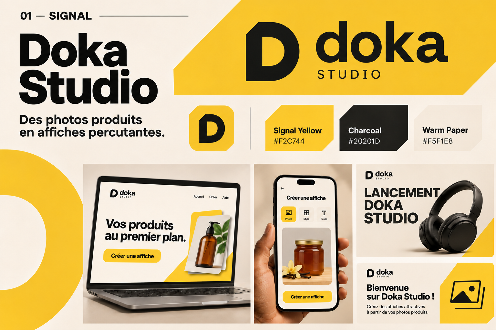
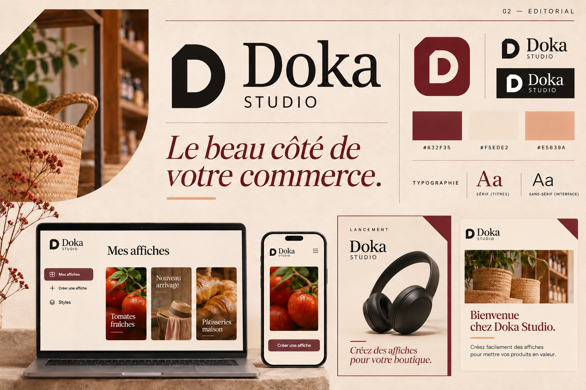
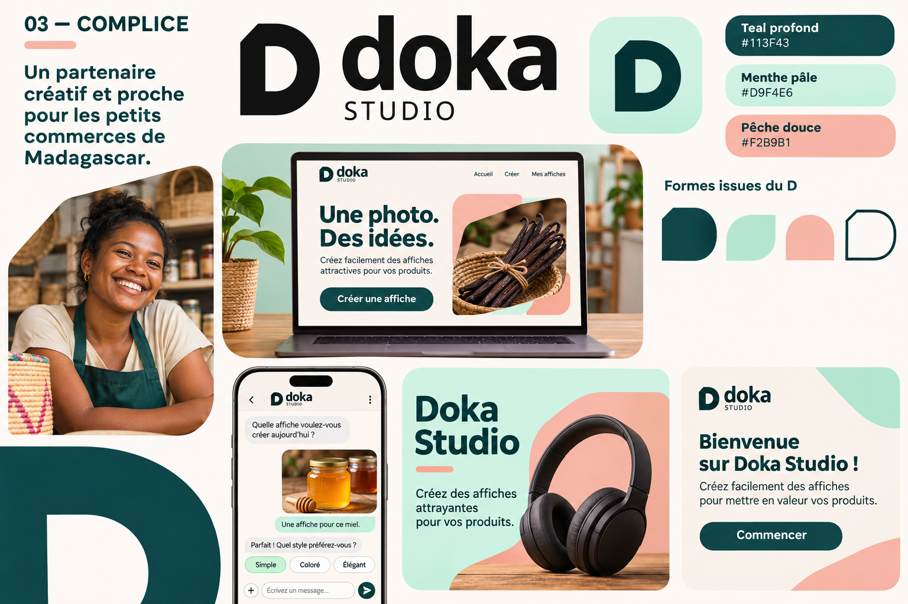

# Doka Studio — identity exploration

2026-11-15 · **Doka Studio and the Signal direction selected by the user.** Developed with the requested `logo-design` and `imagegen` skills. This folder retains the exploration; the requested [Signal digital logo kit v1](../../brand/doka-studio-signal/README.md) is delivered separately. Editorial and Complice are retained as exploration history. Application integration remains separate.

**Selected direction: Signal.** The user preferred Signal after reviewing the three boards. Its bold wordmark, yellow accent and clipped corners give a small app a recognizable signature. No combination with the alternative styles was requested.

## Compare the three styles

| Direction | Personality | Palette | Typography proposal | Main tradeoff |
| --- | --- | --- | --- | --- |
| [01 Signal](boards/signal-board-v2.png) | Direct, energetic, capable | Yellow `#F2C744`, charcoal `#20201D`, paper `#F5F1E8` | Space Grotesk Bold for the wordmark/headlines; Noto Sans for everyday copy | Too much yellow would compete with customer images. |
| [02 Editorial](boards/editorial-board-v2.png) | Considered, refined, boutique | Oxblood `#632F35`, ivory `#F5EDE2`, apricot `#E5B39A` | Noto Serif Regular for the wordmark/headlines; Noto Sans for controls/body | Can suggest a specialist lifestyle studio more than an everyday business tool. |
| [03 Complice](boards/complice-board-v1.png) | Warm, helpful, accessible | Deep teal `#113F43`, mint `#D9F4E6`, peach `#F2B9B1` | Noto Sans Bold for the wordmark/headlines; Noto Sans Regular for copy | Softer and less visually assertive; needs consistent shapes and photography. |

All three keep the cut-corner **D**. Its straight edge, broad counter and rounded right side connect a recognizable initial to the edge of a poster. The supporting visual language changes with each style. Display spelling is **Doka Studio**; the lowercase wordmarks are intentional artwork.

## 01 — Signal

**Promise:** « Vos produits au premier plan. »

Use large, short headlines, off-center compositions, clipped corners and occasional cropped arcs from the D. Paper surfaces carry most content; charcoal carries text; yellow highlights one primary action or a strong launch moment. A starting distribution is 70% paper, 20% charcoal and 10% yellow, adjusted to content rather than enforced as a rule.

Photographs should put the merchant's product first, with clean framing and enough space for its own colors. Keep work areas calm. Reserve the louder shapes for the landing page, onboarding and Doka's own communications. Motion can reveal a card with a short upward movement; reduced-motion mode uses a simple state change.

**Voice:** short, concrete, encouraging. « Ajoutez votre photo. » / « Décrivez votre affiche. » / « Votre affiche est prête. » Avoid claims of guaranteed sales.

**Exact vector studies:** [symbol](source/signal-symbol.svg), [monochrome lockup](source/signal-lockup.svg), [charcoal lockup](source/signal-lockup-color.svg).

## 02 — Editorial

**Promise:** « Le beau côté de votre commerce. »

Use generous margins, serif headlines, fine rules, aligned image columns and an occasional folded corner. Ivory forms the base, oxblood anchors headings/actions, and apricot is a small accent. Paper texture belongs to marketing imagery; functional screens should use plain surfaces for readability.

Photograph craft, food, fabrics and objects with tactile detail and natural light. Retain enough variety to serve electronics and other merchants too. Keep body text and all dense dashboard controls in Noto Sans. Motion should be quiet: brief fades between views rather than decorative page-turn effects.

**Voice:** composed and practical. « Préparez votre prochaine affiche. » / « Une présentation à votre image. » Avoid sounding like a luxury service with a high entry barrier.

**Exact vector studies:** [symbol](source/editorial-symbol.svg), [monochrome lockup](source/editorial-lockup.svg), [oxblood lockup](source/editorial-lockup-color.svg).

## 03 — Complice

**Promise:** « Une photo. Des idées. »

Use mint and warm neutral space, dark teal text/actions, peach accents and rounded shapes cut from the D. Combine people, products and the creation process. Human photography can help explain who the product serves; use consenting real merchants before presenting customer stories.

The chat can feel conversational through clear prompts, spacious messages and visible next actions. Keep help close to the task. Prefer rounded rectangles over making every control a pill. A gentle appearance transition can signal a new result; avoid bouncing financial or status information.

**Voice:** friendly, respectful and specific. « Quelle affiche voulez-vous créer ? » / « Choisissez les images à ajouter. » / « Vous pouvez ajuster le texte. » Use *vous* consistently.

**Exact vector studies:** [symbol](source/complice-symbol.svg), [monochrome lockup](source/complice-lockup.svg), [teal lockup](source/complice-lockup-color.svg).

## What is exact, and what is illustrative

- The nine SVGs in `source/` are editable vector paths, including outlined letters. They contain no embedded raster imagery or live font dependencies. [Typography comparison](type-studies.png) · [comparison SVG](type-studies.svg).
- The boards are **generated raster mockups**, 1536 × 1024. Their typography, logo placement and interface details are approximate. The vector studies define the intended logo; the boards communicate atmosphere and possible applications.
- Generated products and people are fictional examples. They are not actual customers, product facts or endorsements. The app screens are not an approved navigation or feature specification.
- Doka's identity belongs to its service interface and marketing. Customers must remain free to generate posters in their own styles; these boards do not authorize adding Doka's logo to their exports.
- The Editorial board retains a small generated typo, “SÉRIE (TITRES)”; the intended label is **SÉRIF (TITRES)**. Its serif lettering is an approximation of the exact vector study. Do not reuse screenshot text as production artwork.

## Checks and use constraints

The shared D was inspected at actual 16/32/64 px sizes, in monochrome/reverse, circular crops and header contexts. At favicon sizes use the **D alone**; the STUDIO descriptor is unsuitable there. The supplied comparison sheet's tiny full-lockup samples are stress tests, not recommended usages. Use a contrasting monochrome variant on dark backgrounds; the black-on-black and white-on-yellow specimens intentionally expose failures.

Native symbol audit: no issues. Outlined wordmark audits flag font-contour near-angles and path complexity; these are recorded heuristic notices, not evidence of broken SVGs. Do not snap the letterforms to repair those notices.

| Exact text/background pair | Contrast |
| --- | ---: |
| Signal charcoal / paper | 14.49:1 |
| Signal charcoal / yellow | 10.13:1 |
| Editorial oxblood / ivory | 9.10:1 |
| Editorial oxblood / apricot | 5.66:1 |
| Complice teal / mint | 9.93:1 |
| Complice teal / peach | 6.80:1 |

These six flat-color pairs pass 4.5:1. This does not certify generated screens or arbitrary overlays. White text on Signal yellow must be avoided; the refined Signal launch headline uses charcoal.

French accented character coverage was checked against the source font files. Noto fonts and their license already exist in [the app's font directory](../../../../frontend/public/fonts/). Space Grotesk Bold was read from the local installed font for this study; its source font is not bundled here. Retain appropriate font licenses when packaging a future kit. The SVGs themselves do not require installed fonts.

Name/domain/trademark clearance and physical print tests remain open; earlier naming-overlap findings are recorded in [the naming exploration](../brand-directions/README.md#d-doka-studio). No application code or dependencies changed for this exploration.

## Reproducibility and next choice

[Styles and exact colors](styles.json) · [original generation prompts](imagegen-prompts.json) · [refinement prompts](imagegen-edits.json). Boards were generated through built-in imagegen using rendered SVG lockups as references. Original v1 boards remain alongside refinements. Signal v2 corrects launch-copy contrast and uses “Style”; Editorial v2 uses “Styles” in its sidebar but retains the small label typo noted above. Originals in the generated-image directory were preserved.

Local intermediate scripts, logo reference renders, audits, contrast calculations and the symbol test sheet are in git-ignored `outputs/doka-studio-identity-2026-11-15/`.

**Delivered on the user's “go”:** [Signal logo kit v1](../../brand/doka-studio-signal/README.md), with exact vector layouts, transparent PNGs, icon exports, spacing/minimum-size rules and a usage guide. Application rollout is a separate scoped task.
