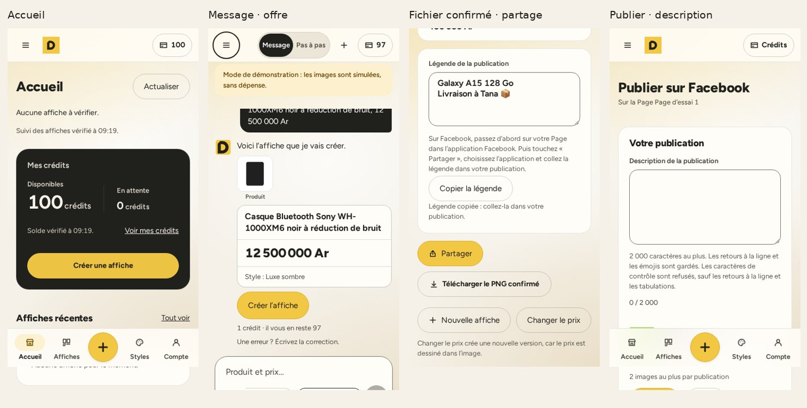

# Doka Studio · From a product photo to a published poster

Product review of release 05a12ee, 22 November 2026. The shop has two successful endings. A seller has the confirmed PNG on their device, or they can open the post on their Facebook Page. Design the first screen backwards from those endings.

## What to change first

| Priority | Where the journey breaks | Recommendation | Observable improvement |
|---|---|---|---|
| 1 | An approved scene and a publishable file have different lifecycles. In the pilot, six « Approuvée » posters were missing from the picker, while two posters with a waiting version qualified. | Keep the exact-file rule. Give each omitted item its name, reason and direct repair action. Return to the same post with its description and order intact. | A seller can find one missing poster, fix it and add it without searching the library or rebuilding the post. |
| 2 | The default guided path requires « Continuer » through Textes and Boutique even when both are already correct. | Summarise the actual defaults beside format and style. Open a section only when the seller wants to change it. | Two mandatory navigation taps disappear from the unchanged-default case. All controls are still reachable. |
| 3 | After a version is approved, the seller returns to a result card to request the final review. After confirming the file, caption tools and manual sharing compete with both endings. | Continue directly to the exact-file review when appropriate, with an edit exit. On confirmation, place « Publier sur ma Page » and « Télécharger le PNG » beside the ready state. Put manual sharing help with manual sharing. | One fewer return to the chat card. An eligible single poster goes into its composer already selected. A PNG needs no caption. |
| 4 | On the phone, Styles has a permanent navigation slot while Publier lives in the menu. The biggest object on Accueil is the balance. | Give Publier that slot for eligible shops. Put creation and the next poster to finish above a healthy balance. Keep Styles at selection time and in the drawer. | At 360 px, a new owner sees how to start and a returning owner sees how to finish. |
| 5 | A first-time user must infer the difference between scene approval, file confirmation and permission to post. | Offer the [French walkthrough](../guide-premiere-affiche.md) after the terms choice and from Help, then show the relevant instruction in the working screen. | The guide can be dismissed, resumed or replayed. Reading it spends zero credits and sends zero posts. |

### Evidence

The live sign-in screen opened in Chromium. The public HTML and local release build referenced the same main JavaScript and stylesheet. Edge exposed a Doka Studio window title on this machine, but the accessibility tree stopped at the frame and the Wayland capture provider could not match the window. Signed-in observations below use Chromium captures with isolated test shops, current Vue templates and the owner's recorded picker report. Solid-colour test scenes establish layout only. No paid generations, real posts, credentials or production mutations were needed.

Phone crops show the balance taking priority on Home, a strong existing offer recap, manual share instructions occupying the confirmed-file panel, and description rules filling the composer. The confirmed-file crop is from the native sharing scenario. The direct Page action is conditional in the release. Additional visual references are listed under each inventory.

## Visual system across the two interfaces

Keep Signal yellow, warm paper, charcoal, Figtree, and the existing light/dark tokens. The poster gives the shop its visual identity. The console gets its identity from clear, aligned operational data. Prioritise these component changes across both.

| Element | Desktop | Phone and interaction |
|---|---|---|
| Navigation | Keep the named rail and its existing collapsed state. Highlight the current destination with one treatment. | Label the central create action. Keep a clear route back from focused chat, editor, preview and publishing. Respect safe areas and the keyboard. |
| Primary action | One filled Signal action per decision. On an eligible ready file, use Signal for direct publishing, a neighbouring labelled control for PNG and a quieter native-share action. Where direct publishing is unavailable, promote PNG. | Present output choices above a tall preview or caption. Keep 44 px touch targets and the existing larger touch form controls. Destructive actions have a distinct confirmation. |
| Poster rows and selection | Align the thumbnail, title, exact offer, file state and next action. Use menu actions for occasional operations. Keep an ordered strip for a batch. | Give the title room to wrap, keep the next action within reach and label row menus by product. Convey active, pending and unavailable states with text as well as colour. |
| Type, numbers and spacing | Keep existing type roles. Use the heading for the task, a single label for each field and tabular right-aligned amounts in financial lists. Reduce nested panels around one object. | Use readable control text and wrap long French titles, Page names and ariary amounts. Keep essential reasons beside a disabled control. Reserve timestamps and technical rules for when they answer a question. |
| Inputs, sheets and feedback | Use the same field, focus, status and confirmation patterns. Put errors beside the field and preserve typed values on retry. | In a long sheet, separate its scrollable body from reachable actions. Restore focus to the initiating control; announce save, pending and error states. Respect reduced motion. |
| Artwork | Keep generous preview space, correct aspect ratio, the original photo and full-size inspection. Put editing controls in an adjacent inspector. | Keep a reachable zoom/compare action; show one active tool at a time. Keep shop artwork and branding independent of interface theme. |

## Shop screens and recommended changes

| Screen | Evidence and simplification | Acceptance check |
|---|---|---|
| Sign-in and session recovery | Two labelled fields already suffice. Keep the quiet centred form, identify the shop login in its heading, keep support contact and public data page visible. Keep session/network/leftover-browser-data alerts beside the form when relevant. | Password manager, submit on Enter, support and privacy work at 360 px with keyboard open. Account switching never exposes a prior shop's drafts. |
| First sign-in / changed terms | Full dated terms currently occupy more than a phone screen. Use a scrollable reading region, clear version and reachable consent/defer actions. Keep consent at first sign-in as required. Add the first-poster guide after this choice. | Defer permits existing free edits and PNG download; generation and direct publishing still require acceptance. A changed version is explicitly accepted. |
| Public « Vos données » | The first section is a long retention list before readers reach « Effacer vos données ». Add in-page links to existing sections, comfortable text width on desktop, and a visible deletion/contact jump near the title. | Link works while signed out; all details, deletion instructions, and return to atelier remain readable in both themes. |
| Shell | Desktop rail gives Publier a destination. At 360 px the five slots show Accueil, Affiches, +, Styles, Compte. Allocate Styles' phone slot to Publier when enabled; keep Styles in drawer and directly accessible while choosing a style. Put a visible « Créer » label on the centre +. | Reach both primary destinations with one tap outside the editor. Keep full editing, Android keyboard space, collapsed rail labels and disabled-publisher shops. |
| Accueil | Current phone capture gives the largest dark card to balance. Creation sits inside it and recent posters below it. Put « Créer une affiche » beside the heading or first-run guide, then the highest-priority resumable poster with thumbnail and concrete action. Compress the healthy balance into the existing pill. Keep attention/failure states, low-credit action, full balance and retry/timestamps when stale. | A new shop can start immediately; a returning shop can resume a pending review from the first screen. No request failure masquerades as zero. |
| Mes affiches / retirées | Current mobile heading stacks instructions, two CTAs and removed checkbox. Each row repeats duplicate/remove. Keep open/resume and the current final-file action visible. Put duplicate/remove/restore in an accessible named row menu; keep removed items discoverable as a filter. Compare visual fidelity and final-file eligibility separately. A waiting alternative can coexist with a publishable final file. | From a confirmed current file, download or open single-post composer without reopening editing. An unconfirmed file offers the correct check. Preserve duplication of removed items, restoration, pagination and guarded removal. |
| Styles / style detail | Three supplied styles and saved examples already communicate visually. Group by « Styles fournis » and « Mes styles ». Move the repeated type labels to group headings. Make the existing style chooser reachable from the current draft. | Browsing a reference alone never initiates an AI job or changes a draft. Existing style import, saved sources and costs remain available. |
| Crédits / in-editor balance panel | Available, pending, activity and ledger serve different decisions. Lead with available credit, show pending beside it when nonzero, and put purchase instructions next. Keep 30-day usage and complete history below. | Negative balance, service pause, unavailable/stale data, adjustments and pending amounts remain distinguishable; closing in-editor panel preserves unsent text and attachments. |
| Mon compte / Page picker / callback | Publish without connection currently links to top of account, before the profile form. Target the Facebook section directly, keep the issuing poster or batch draft, and offer return to the composer after the Page choice. Keep connection, disconnect and actual Page name visible. Put >100 Pages explanation in Page-missing help. Collapse password controls until requested. Keep the callback lightweight with explicit recovery and current privacy behaviour. | Test cancel, expired choice, wrong session, unsaved shop details, conflict, reconnect and successful return. Keep selection and order, send no post by returning. |
| Publier, batch and single | On phone, six-row description plus technical rules pushes the first image picker below the first screen. Preserve owner's description-first order. Use a shorter expanding field, counter and inline validation when needed. Follow with selected thumbnails and a visible « Choisir des affiches » shortcut. Keep keyboard and touch reorder including first-image marking. Single entry already supplies the image; remove any extra image selection. | Existing and conflicting drafts survive entry/return; adding images respects the shop cap. Choosing an image or entering the composer never sends. |
| Missing posters | Current picker groups omissions into counts, with every reason linking to #affiches. The pilot owner encountered this in production. Show title, exact reason, and recovery link to that poster; point a format mismatch to the correct format operation. | The owner can find and repair a named excluded poster, return to the same post and select it. Server remains authoritative on current confirmation, eligibility and final format. |
| Publish preview / history | Distinguish the first « Publier… » (opens preview) from the final action by labelling the first « Vérifier la publication ». Keep final destination Page, actual ordered images and optional caption together. Put unfinished/unknown outcomes above past successes, even when disconnected; collapse old history into a disclosure. | Send exactly once; an unknown answer never suggests automatic resend. Confirming absence/repeat, interruption, cancellation, no Page and post link vs Page link all remain explicit. |
| Confirmed file / download and share | On supported phones, native « Partager » owns the primary button while its caption and Facebook instructions come before download. Put « Télécharger le PNG » and direct Page publishing immediately after confirmation. Move caption help next to its destination; expose native JPEG share distinctly as « Partager dans une autre application ». Keep previously confirmed downloads visibly dated. | Re-downloading identical current file needs no extra review. A stale file cannot be sent as current. No duplicated caption entry on single-poster publishing; clipboard/file refusal still permits PNG download. |

Evidence: current Vue templates in frontend/src/App.vue, ShopHome.vue, ShopCredits.vue, ShopAccount.vue, ShopPublish.vue, facebook-return.ts; frontend/public/donnees.html. Inspected Nov 22 phone/desktop smoke screenshots in outputs/shop-dash, outputs/publish-browser, outputs/share-browser, outputs/terms-browser; consulted the older Nov 20 design-capture/after for sign-in, library and style gallery. The Nov 20 shell predates the released sidebar and phone bar. Screenshots represent local stub data. No real phone, real Page post or user comprehension test performed.
## Shop creator, editor and outputs

Visual evidence: November 21 captures in `outputs/chat-smoke/` (empty, recap, result, retry), `outputs/editor-smoke/` (style step, product review, square and story), `outputs/editor-refinements/controls-360.png`, and November 22 captures in `outputs/share-browser/` (confirmed, earlier, share unavailable, publication history). The older `design-capture/after/sheets/` shows the previous shell. The solid-colour generated images are stub fixtures and cannot establish legibility against real artwork.

| Surface | What the shop encounters | Recommended change and behaviour to retain |
| --- | --- | --- |
| New message | Welcome question, inspiration suggestion, image picker, styles and message field. On a phone, a horizontal strip clips style names. | Ask for the actual inputs in order. « Ajoutez la photo du produit, puis indiquez son nom et son prix en ariary. » Make « Photo du produit » visible beside the attachment control before the first upload. Put the selected style in one button opening the full picker. Keep optional inspiration and explicit image roles. |
| Chat recap and attachments | The recap already brings photo, offer, style and cost together. A correction uses another message. | Preserve this recap and make its cost part of the named action. Mark product and inspiration clearly and allow spelling/price corrections before generation. Avoid an additional confirmation after this deliberate paid tap. Existing posters accept a new product photo through a free copy, then open the guided editor. Preserve the original and keep the copy's first generation explicit. |
| Chat result, refinements and interruptions | Desktop has the result image in the conversation and the same image beside it. Phone keeps a small poster and « Modifications ». Uncertain sends, another tab, blocked charges and failed reads have dedicated recovery controls. | On wide screens keep the inspectable poster by the conversation and use an actionable version reference in the message. Keep an image reachable on a phone with one tap. Use « Versions » for history in both modes. Separate a pending job, retrying the same request and choosing a new paid version. Preserve fallback to Pas à pas, prior versions and free restoration of the exact saved words where supported. |
| Guided offer | Product photo, variant, price and attestation precede an expanded shop identity form. After creating the draft a user revisits text and shop controls. | Collapse saved identity to its actual logo/name/contact summary with « Modifier ». Retain the 1–3 original photos, explicit variant and photo match, low-resolution handling and integer price validation. Distinguish saved shop defaults from changes for this poster. |
| Guided preparation | `App.vue:474–487,2504–2508` limits unvisited tabs. Textes → Boutique → Style needs two Continuer taps even if defaults are correct. | After the product form show a single review with editable title/price, selected format, style and shop identity. Give advanced text, signature, placement and palette independent sections. The default route should save two navigation taps, while consent for cost, format lock and low-quality photo remains visible before generation. |
| Style library, detail, reference import | Presets are illustrated, names and editability differ between supplied and owned styles. Creating one from a reference lives in the editor. | Reuse the same thumbnail, name and selection treatment in chat, form and library. Keep direct use from the library, details/rename/remove on owned styles, palette override, custom ambiance and paid reference extraction. Preserve a removed style on an existing poster. Explain that only Publication format can go directly to a connected Page before generating. |
| Generation wait/failure | A poster may have a previous version while a new job runs. Cost can be pending, blocked or exhausted. | Show the job's actual status once alongside the last usable poster. Put the recovery action at the point of failure. Keep explicit balance, eligibility, terms and retry semantics. |
| Layer editing and history | Settings and the canvas both offer element selectors; the phone has preview, versions, tabs, credits and an output action. | Keep one layer selector in each visible layout. Desktop canvas selection synchronises with its inspector. On phone keep the compact preview and one settings panel. Offer versions as a sheet with compare/choose and rejection reason. Preserve zoom, bounds, keyboard operation, editable positions, typography, logo, undo/redo, save state and stale-state recovery. Explain a generated product stays in its scene. |
| Fidelity review | Original photo(s) and generated version are compared. A single approval already covers applicable checks. | Name the decision « Vérifier le produit et les textes ». Keep side-by-side comparison on desktop, persistent image switch and zoom on phone, exact generated words/amount, logos and refusal reason. After approval, offer or advance to the exact rendered file for a separate review. An edit route must remain available before confirmation. |
| Final check, current and earlier renders | Final heading mentions download only. An immutable render can precede recent edits. Desktop juxtaposes PNG and checks; mobile separates them vertically. | Use « Vérifier le fichier final » with amount, version and format adjacent to the preview. Keep explicit confirmation of this render and full-size inspection. On a previous file label the version/date and offer current-file verification; keep valid past downloads visibly historical. |
| Confirmed output | The caption field, clipboard button and instructions to switch Pages in the Facebook app precede direct Page publishing and downloading. Native sharing can be primary. New poster, price change and publication history compete below. | Place « Publier sur ma Page » (when eligible) and « Télécharger le PNG » together directly beneath « Fichier prêt ». « Partager dans une autre application » reveals local caption, copy, JPEG preparation and manual Facebook instructions. Preserve the caption passed to the direct Page composer and the accessible fallback download. Keep other actions and history under « Autres actions » / « Publications ». On phone ensure output actions are reachable before a full-height image. |
| Paid, terms and stale dialogs | First AI use, low balance, old final file, change elsewhere and unconfirmed price have different consequences. | Retain distinct labels and explicit consequences; return focus and the owner's inputs to the interrupted task. Never auto-accept terms or send a new paid request on return. A shop without accepted terms can still edit, verify and download. |

The [French first-poster guide](../guide-premiere-affiche.md) uses the current control labels and covers recovery after interruption.
## Operator console and public surfaces

| Surface | What the operator or owner encounters | Change to make |
| --- | --- | --- |
| Operator sign-in | One labelled password, Doka lockup and a sign-in action. | Keep the one-field entry and password-manager support. Match field, focus, error and submit treatment to shop sign-in. Put the operator role in the title so the two entry points remain distinguishable. |
| Overview | Four figures precede “Needs you”. On a 360 px phone, even an unresolved money operation sits below the full metric stack. Then as many as eight shops repeat much of the directory. | Put actionable exceptions first and link each to its resolution. Collapse a verified clear queue to one line. Show figures side by side on desktop and in compact pairs on mobile. Shorten the recent lists and keep “View all”. An unread section must still identify what could not be checked. |
| Shops | Search and tabular balance/state work on desktop. Each phone row stacks identity, state, available and pending credits, posters, last activity and sessions. “En attente” is French inside the English console. | Keep identifier search. Use identity, state and balance in the mobile row, put sessions and dates in the detail view. Print “Pending credits” consistently. On desktop, keep money columns aligned. Keep unresolved requests visible in both layouts. |
| New shop and one-time credential | Identifier rules, optional name and welcome credits fit in a single window. A separate panel shows the issued credential. | Keep both steps. Add a short example to the identifier field, retain live refusal and preserve a cancelled form. Show the generated password only at issuance, with copy result and focused close action. Keep an explicit handoff when clipboard access fails. |
| Shop detail, grants, corrections, transfers, repayment, access and limits | Header and balance precede a long grant form. Access and limits sit below the paginated ledger. A large grant confirmation can turn into a paragraph of identifiers, name, amount, method and reference. | Put balance, status and unresolved work first. Use “Grant credits” to open the existing form and put “History” and “Access” within reach at the top. Use labelled rows in confirmations and retain complete values. Keep correction, move, repay, session termination and suspension distinct. Show retry on uncertain monetary operations as the same request. Keep the CLI-only Facebook post-image limit documented in operator help. |
| Payments | The default month is loaded automatically. The mobile date form occupies most of the first half of the viewport and live amounts sit below it. The shop identifier in the payments table is plain text. | Lead with period and total and offer “Change dates” for the inclusive UTC range. Keep the range that produced the currently shown results distinct from unsaved filter changes. Make the shop name link to its ledger. On narrow rows show the shop, amount and date first with reference, actor, credit delta and notes accessible on expansion. Name the transaction kinds in operator language. |
| Service | Health, a multi-sentence spend calculation, pause, purchase text, daily limits and every live session have equal card weight. Long browser identifiers fill the bottom of the page. | Show operational exceptions first. Present remaining cap and estimated cost of outstanding credits as two labelled figures with arithmetic available on demand. Keep service-wide pause with the consequences beside the control. Disclose purchase-text editing, technical fields and sessions. Summarize sessions by device, date and current session, with full details accessible. Preserve the distinction between unknown backup status and a healthy backup. |
| Conditions | With a new shop, the versioned text fills the mobile viewport before either “J’accepte” or “Plus tard”. The legal modal can precede any opportunity to see a poster. | Keep version, complete text, explicit consent, “Plus tard”, server revalidation and AI gate. Pin the two actions outside the scrollable document with safe-area clearance and keyboard reachability. Introduce the tutorial after dismissal. If changing when the terms appear, review the existing first-login requirement explicitly. |
| Vos données | A long first section on storage precedes local data, providers and deletion. The only return link sits at the bottom. | Add in-page links for storage, providers and deletion plus a top return link. Lead with the practical Facebook disconnect and deletion instructions in the relevant section. Keep the public address, full disclosures and readable 680 px desktop column. |
| Facebook authorization return | The callback intentionally shows a transient status and a recovery link. It removes the query before loading assets and returns to Mon compte. | Use readable inline system-font styles for progress/error and one clear recovery action. Keep it automatic with zero added steps. Preserve the page's no-referrer, no external assets and query cleanup. Match the Page chooser or recovery view to the publishing task on return. |

Evidence comes from a local stub render of the production bundle at 360 × 780 and 1440 × 900 in both themes, the operator smoke’s long-data and unresolved-request screenshots, and the views in frontend/src/admin. The callback was reviewed in frontend/facebook.html and frontend/src/facebook-return.ts. The older outputs/design-capture/after operator sheets predate the current four-destination rail and Overview. The privacy and terms review concerns navigation, layout and legibility.

## How to evaluate the redesign

1. Give a first-time shop worker a real product photo and a verified test offer on an isolated instance. Ask them to produce the confirmed PNG. Observe time to first generation, backtracking, help required and whether they detect a deliberately incorrect price before approval. Run the message and guided routes separately.
2. Give a returning worker one confirmed poster and one with an approved scene but an outstanding file check. Ask for a two-image Facebook post with the second product first on a stub Page. Check order, saved caption, named destination, exactly one explicit send and the post link. Interrupt once after sending and observe recovery.
3. At 360, 768 and 1440 px, in both themes, repeat with long titles, zero credits, failed reads, old confirmations, missing thumbnails, no connected Page, a second tab and an open phone keyboard. Check focus, zoom, reachability, no lost edits and independent PNG download. Verify TalkBack and real device sharing separately.
4. Ask an operator to locate an uncertain grant, inspect the ledger and resolve the existing request before starting any new adjustment. Check critical warnings remain visible with long shop lists and on a small screen.

Use the current flow as the baseline. The two redundant guided taps are counted from source; the time saved, completion rate and visual comprehension require observed users. One overlooked documentation issue: root PRODUCT.md still describes native sharing as the only route to Facebook. Use the released direct Page flow as the authority for help copy.
